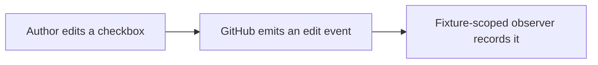

[Agent] Synthetic PR for the manually authorized GitHub interaction tests of 2026-10-11.

## What this fixture changes

Adds one non-executable fixture document. It will not be merged and does not
change the product repository, Home Assistant or release automation.

## Description task-list probe

- [ ] PR-body check A
- [ ] PR-body check B

## Illustrated explanation

The description remains explanatory text. Review commands are tested in a
separate conversation comment. All comments and options here are synthetic.
